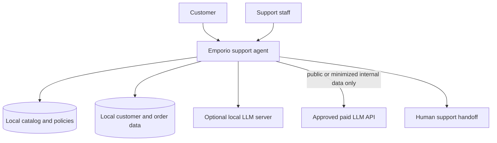
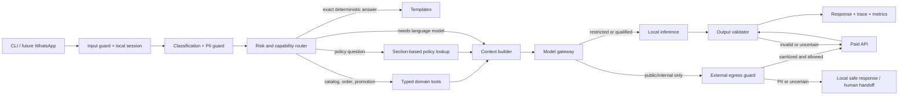

# Recommended architecture

## Decision

Use a **single-agent, tool-first cascade** with a provider-neutral model gateway. The
orchestrator owns the conversation; deterministic application code owns facts, access
control and routing. A model never reads the raw CSV files directly and never decides
whether identity verification succeeded.

## System context



The application is the policy-enforcement point. Models do not access repositories
directly. Customer/order storage and identity verification remain inside the local trust
boundary.



The fallback arrow from local to paid is exceptional and is never permitted for raw
restricted data. High-risk order, identity and complaint paths remain deterministic/local.
Paid inference may receive only a minimized, non-identifying abstraction that passes the
egress guard. Routinely calling both models also increases cost and latency.

## Request lifecycle

1. Normalize the message and attach a session ID; redact sensitive values from logs.
2. Classify the turn with deterministic rules first. Use a cheap/local classifier only
   when the rule set cannot decide.
3. Assign both risk (`low`, `medium`, `high`) and data classification (`public`,
   `internal`, `restricted`, `secret`).
4. Retrieve facts through typed tools. Tool output is structured JSON with a source ID.
5. Build the smallest context needed for the turn.
6. Choose a model from the capability registry. Restricted data is limited to local
   inference or deterministic logic; external adapters accept only public/internal data.
7. Require structured output for routing and tool calls; validate it against a schema.
8. Validate factual claims and policy citations. If a local result fails, retry once on
   the paid primary only when the serialized payload is public/internal and passes the
   egress guard. Do not recursively retry.
9. Return a concise PT-BR answer and record latency, cost, route, tool calls and outcome.

## Routing policy

| Route | Examples | Default execution |
|---|---|---|
| Deterministic | address, opening hours, supported payment methods | template fed from canonical policy data |
| Low risk | greeting, intent classification, query rewriting, catalog explanation | local candidate after qualification |
| Medium risk | product comparison, unavailable-item alternatives, multi-turn catalog help | local only if it passes this slice; otherwise paid economy/balanced |
| High risk without PII | returns, warranty, ambiguous policy | paid primary if the sanitized payload passes egress controls |
| Restricted | order, tracking, identity, customer details, complaint containing PII | deterministic/local only; optional abstract external generation after redaction |
| Forced escalation | invalid schema, unsupported tool call, missing source, low confidence, repeated turn | local safe response or human handoff when restricted; paid fallback only for non-restricted data |

Routing based only on a model's self-reported confidence is prohibited. Confidence is a
combination of route class, schema validity, tool evidence, retrieval coverage and known
evaluation performance for that intent.

## Core components

### 1. Orchestrator

Keep the first version as an explicit Python loop. A framework may wrap the loop later,
but business decisions must remain visible and testable. A multi-agent design is not
justified by this case: there are few tools, one business domain and short conversations.

Split agents only if evaluation traces show repeated tool confusion or instruction
interference after prompts and tool schemas have been simplified.

### 2. Domain tools

- `search_products`: filters by category, name, price, status and stock.
- `get_product`: returns exact price, stock, status and specifications.
- `get_active_promotions`: joins promotions to products and computes display price.
- `verify_order_identity`: code-only comparison of order ID plus phone or email.
- `get_order_status`: available only after successful verification in the session.
- `lookup_policy`: retrieves one or more curated policy sections and source IDs.

Use Python/SQLite or in-memory indexes for the small data volume. Do not use an LLM to
generate SQL for this dataset.

### 3. Policy retrieval

The policy manual is an eight-page PDF with stable numbered sections. Start with a
curated Markdown representation and a section/keyword index, not vector search. Add
embeddings only if the retrieval evaluation shows a measurable recall gap. This reduces
dependencies and makes policy citations auditable.

### 4. Model gateway

Expose one internal contract:

```text
generate(messages, tools, response_schema, model_profile, timeout) -> ModelResult
```

`ModelResult` contains provider/model snapshot, text, parsed output, tool calls, token
usage, cached tokens, latency, finish reason and error class. Provider-specific SDK types
must not leak into the domain layer.

Every external adapter must call the privacy boundary immediately before network
serialization. `src/emporio_agent/privacy.py` fails closed on restricted classification,
PII patterns, sensitive fields, known customer values or unsafe provider options.

Recommended adapters:

- OpenAI Responses API for OpenAI tool workflows.
- Anthropic Messages API for Claude.
- Gemini API for Google models.
- An OpenAI-compatible endpoint for local serving; vLLM is the production-oriented
  starting point, while Ollama is acceptable for developer laptops.

### 5. Capability registry

Configuration, not prompts, defines each model's capabilities:

```yaml
profiles:
  local_low_risk:
    provider: local
    model: ${LOCAL_MODEL_ID}
    supports_tools: true
    supports_json_schema: true
    qualified_slices: [greeting, catalog_search, out_of_scope]
  paid_primary:
    provider: ${PAID_PROVIDER}
    model: ${PAID_MODEL_ID}
    supports_tools: true
    supports_json_schema: true
```

Store dated model IDs/snapshots in production when the provider supports them. Changing a
model or prompt creates a new evaluation run and cannot silently change the default.

## Deployment profiles

| Profile | Behavior | Use |
|---|---|---|
| `paid_baseline` | all externally eligible turns use the strongest paid candidate; restricted turns stay local | quality reference |
| `paid_optimized` | deterministic/restricted local paths + economy paid model and eligible strong paid fallback | default when local TCO or quality fails |
| `hybrid_shadow` | paid answer is shown; local runs asynchronously for comparison | qualification without user risk |
| `hybrid` | qualified slices use local; paid handles the externally eligible remainder; restricted turns stay local | only after release gates pass |
| `local_dev` | local model, fake/redacted customer data, no production claims | offline development only |

## Reliability and security boundaries

- Prices, stock, promotion state, order state and tracking must be copied from tool output.
- A failed or missing tool result produces an honest limitation, never a guessed answer.
- Treat policy text, product descriptions and user messages as untrusted data; they cannot
  override system instructions or authorize a tool.
- Return no order detail until application code has matched order ID plus phone or email.
- Raw PII, order IDs, tracking codes and conversation history never cross an external
  provider boundary, regardless of contractual ZDR assurances.
- Log hashes or masked identifiers, not raw customer phone, email or tracking codes.
- Disable provider storage/log contribution, file upload, hosted caches and external tools
  on any route derived from restricted data.
- Apply timeouts, one bounded fallback, circuit breakers and per-provider budgets.
- A provider outage must degrade to deterministic answers and a safe handoff message.

## Observability

Every turn should emit one trace with: `trace_id`, profile, route reason, risk, provider,
model ID, prompt version, retrieval section IDs, tool names, validation result, fallback
reason, input/output/cached tokens, estimated USD cost, time to first token, total latency
and a PII-safe outcome label.

## Deployment view

| Runtime unit | MVP location | State | Network access |
|---|---|---|---|
| Python CLI application | Developer or evaluation host | Local session and generated SQLite database | Approved model endpoints only |
| Source fixtures | Local read-only workspace | CSV and PDF inputs | None |
| Local model server | Optional separate local/GPU process | Model weights and ephemeral inference cache | Local/private endpoint only |
| Paid model API | External provider | Provider-controlled under approved terms | Receives only guarded public/internal payloads |
| Evaluation artifacts | Local workspace | Synthetic cases, metrics and redacted outputs | None by default |

For the prototype, all business state runs in one Python process. Repository, tool,
orchestration and adapter boundaries are logical modules rather than independently
deployed services. This keeps failure modes visible and avoids premature distributed
systems complexity.

## Architecture decision boundaries

- Split a second service only when deployment, scaling or security isolation requires it.
- Add a vector index only after retrieval recall fails its frozen test set.
- Add multiple specialist agents only after trace evidence shows persistent tool or
  instruction interference.
- Enable a local task slice only after its quality, latency, cost and privacy gates pass.
- Replace SQLite only when concurrency, persistence or operational requirements exceed the
  prototype boundary.

