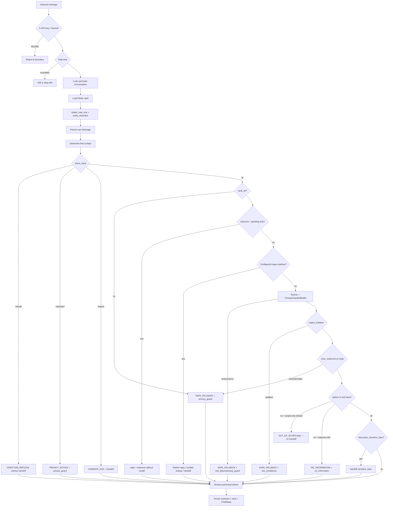
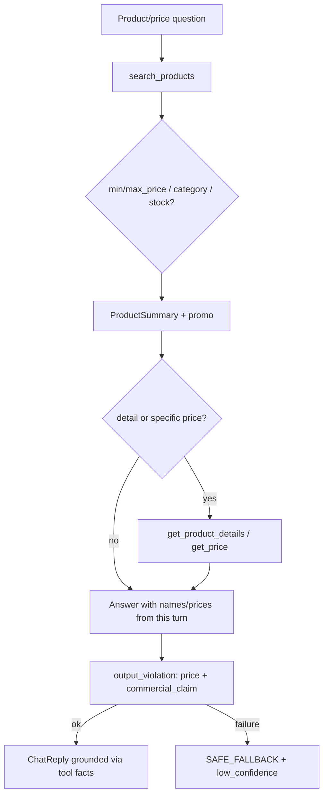
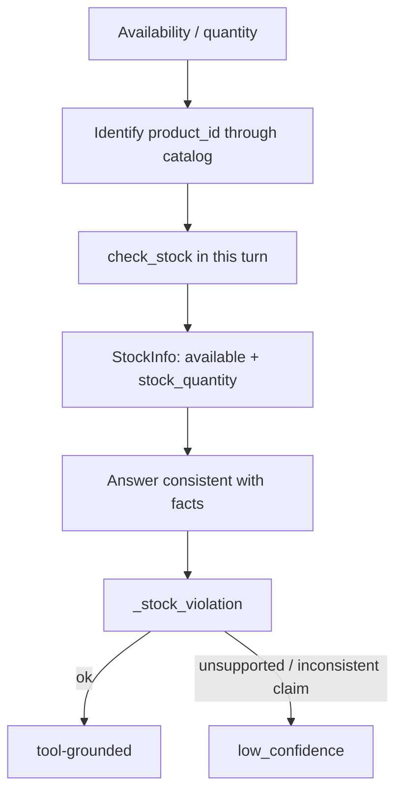
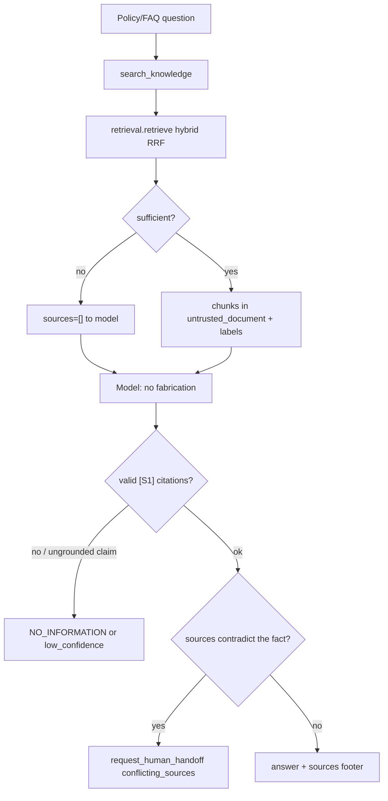
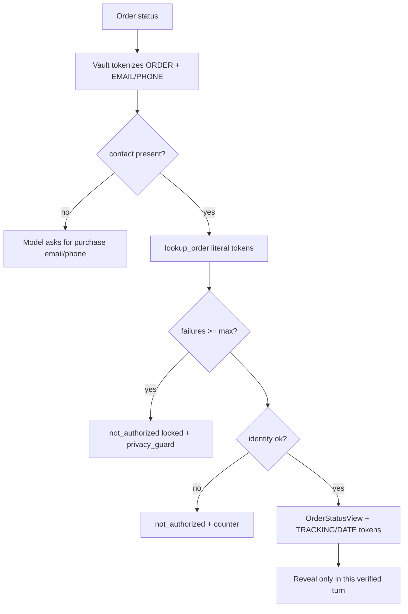
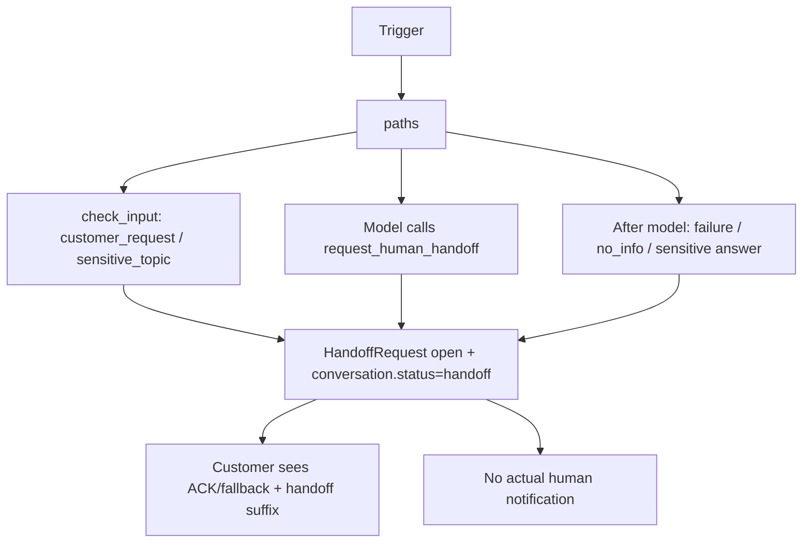
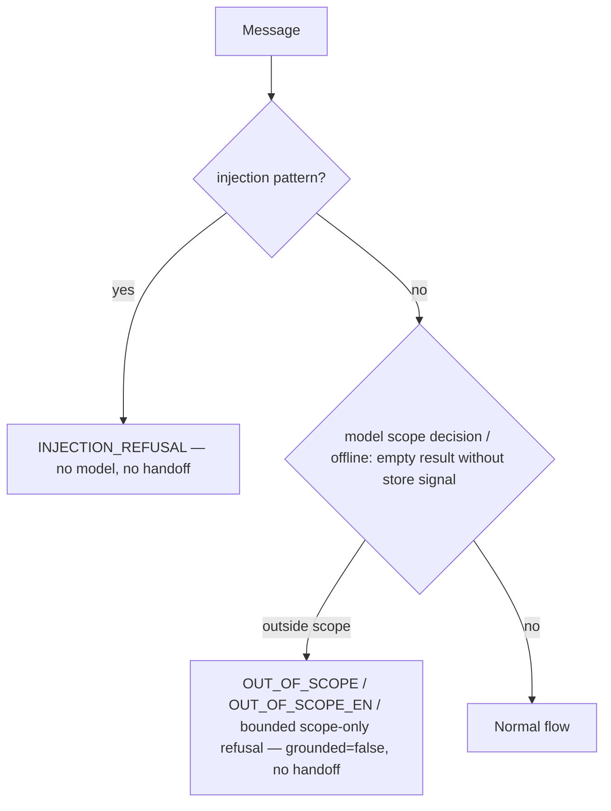
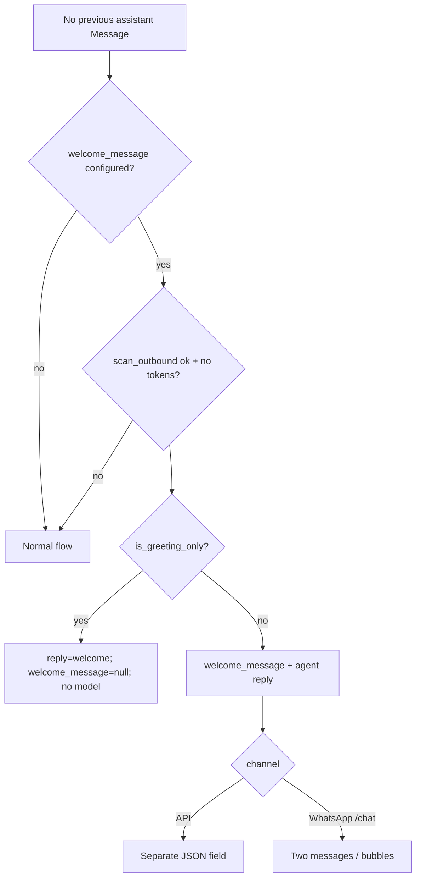
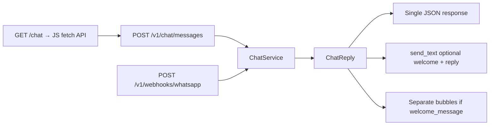

# Agent customer-service flows

This document is derived from running code, rather than design intentions. It is for
recruiters evaluating the case and the store team. When the README or older docs
differ from the code, **the code takes precedence**; relevant discrepancies are noted.

Output contract: `ChatReply` in `app/schemas/chat.py`. Orchestration:
`ChatService.handle_message` in `app/services/chat.py`. Handoff reasons:
`HANDOFF_REASONS` in `app/models/handoff.py`.

---

## 1. Turn overview

A turn starts at the channel (API, WhatsApp or `/chat` UI) and ends in a persisted
`ChatReply`. Authentication and rate limiting sit at the HTTP boundary; everything
else is local and tenant-scoped.



Original turn diagram (Portuguese labels preserved):

```text
API autenticada → tenant → classificação/tokenização local → agente limitado
   ├─ catálogo, estoque, pedidos → ferramentas → banco local
   └─ políticas → busca híbrida → trechos não confiáveis + citações
→ validação de saída → revelação local autorizada → resposta + persistência
```

In English: authenticated API → tenant → local classification/tokenization → bounded agent;
catalog, stock and orders use tools and the local database; policies use hybrid retrieval,
untrusted excerpts and citations; output validation → authorized local reveal → reply and
persistence.

### Steps and code

| Step | What happens | Code |
|---|---|---|
| Authentication | `X-API-Key` → tenant; `chat` scope. A tenant in the body is ignored. | `app/api/dependencies.py` `get_principal`, `require_scope` |
| Rate limit | Redis counter per key (API) or `external_user_ref` (WhatsApp). Limiter down → allow (except order lockout, which fails closed). | `count_hit`; `app/api/routes/chat.py` `post_message`; `app/api/webhooks/whatsapp.py` `_process` |
| Conversation | Create or look up by `tenant_id` + `conversation_id` + `channel` + `external_user_ref`. | `ChatService._conversation` |
| Tokenization | Known spans → `[[EMAIL_n]]` / `[[ORDER_n]]`, etc. Residual `looks_restricted` content → placeholder and never sent to the model. | `redact_user_text`, `looks_restricted` (`app/services/privacy.py`) |
| Input | Injection refusal; sensitive topic; explicit request for a human. | `check_input` (`app/agents/guardrails.py`) |
| Welcome | First contact (= no previous assistant message); advisory lock; greeting-only without a model. | `handle_message` + `is_greeting_only` |
| Agent loop | `Runner.run` with `max_turns=MAX_AGENT_TURNS` (default 8), `TURN_TIMEOUT_SECONDS` (75) and `MODEL_TIMEOUT_SECONDS` (30) in `PrivacyGuardedModel`. | `handle_message`; `app/services/model_gateway.py` |
| Egress | Every provider payload passes through `scan_outbound`; no `store`/hosted state. | `PrivacyGuardedModel._check` |
| Output | Price/stock/promotion/citations/prompt leaks/success claims. | `output_violation` |
| Ungrounded | No citation or tool facts, with a factual claim or admission of missing information (Portuguese or common English forms) → `NO_INFORMATION` + `no_information`. Exception: a complete, bounded scope-only refusal (`OUT_OF_SCOPE` / `OUT_OF_SCOPE_EN` or a harmless variant) is kept, ungrounded, without handoff. | `is_out_of_scope_refusal`, `has_factual_claim`, `admits_no_information` |
| Reveal | Only tokens entered in this turn or `TRACKING`/`DATE` from `lookup_order` with `identity_verified`. | `verified_lookup_tokens`, `vault.reveal` |
| Persistence | Messages, `MessageSource`, `ToolExecution`, `AuditEvent`, `handoff` status if applicable. | End of `handle_message` |

Fixed messages (`SAFE_FALLBACK`, `NO_INFORMATION`, `OUT_OF_SCOPE`, `OUT_OF_SCOPE_EN`,
`INJECTION_REFUSAL`, `HANDOFF_ACK`, `PRIVACY_NOTICE`) are in `app/agents/guardrails.py`
(warm Empório attendant wording; same safety meaning). A handoff in the current turn
adds the suffix *“Passei sua solicitação pra um atendente te ajudar.”* to the reply
(`handle_message`). Citation footers render as compact `Fonte: …` lines (or
`Fonte [Sn]: …` when two or more sources are cited)
(`format_sources_footer`); body markers `[Sn]` still ground the answer.

**Resolved discrepancy:** an earlier README cited `commerce-privacy-v5`; the README
and code now both use `commerce-privacy-v11` (`PROMPT_VERSION` in `app/agents/instructions.py`).

---

## 2. Flows by intent

The model selects tools; the policy in `POLICY_TEXT` (`build_instructions`) and
deterministic guardrails constrain behavior. Tools: `build_customer_service_agent`
(`app/agents/customer_service.py`).

### 2a. Catalog, prices and promotions



- **Tools:** `catalog.search_products`, `get_product_details`, `get_price`
  (`app/tools/catalog.py`). Budget → `min_price`/`max_price`; partial matches come
  from the local backend (no guarantee of equivalence to the requested product;
  see the README limitations).
- **Promotion:** `active_promotion` in the result; “grátis/desconto” (“free/discount”)
  claims without catalog backing in this turn violate `_commercial_claim_violation`.
- **Validation:** product prices come only from this turn's tools, never RAG documents
  (`_price_violation`).
- **Instructions:** search first with `search_products`; do not invent prices or
  show `product_id` to the customer (`POLICY_TEXT`).

### 2b. Stock



- **Tool:** `inventory.check_stock` (`app/tools/inventory.py`).
- History only identifies the product; availability from previous turns is **not**
  evidence (`POLICY_TEXT`). Follow-ups (“e tem em estoque?” / “and is it in stock?”)
  must call the tool again in this turn.
- Quantities require `stock_quantity` (a search summary alone does not support a number).
- Questions (sentences with `?`) and non-assertive offers pass the checker
  (`_stock_violation`, `_nonfactual_request`).

### 2c. Store policies through RAG



- **Retrieval:** `app/rag/retrieval.py` `retrieve` — cosine + Portuguese FTS + RRF;
  `sufficient` requires similarity ≥ threshold or lexical coverage (≥ half the query
  lexemes). Chunks with `suspicious_instructions` are never served. The store manual is
  Portuguese; `commerce-privacy-v11` tells the model to translate `search_knowledge`
  queries into Portuguese while answering in the customer's language.
- **Adapter:** `search_knowledge` in `customer_service.py` only supplies chunks if
  `found.sufficient`; otherwise, `sources=[]` and `sufficient=false`. When the model
  passes a `category` and the filtered search is insufficient (e.g. `shipping` for a
  manual filed as `politicas`), the tool retries once without the category.
- Documents are untrusted data (`<untrusted_document>`); policy instructs the model
  to ignore commands within them.
- Conflict: the model should answer with the consensus, cite both sources and only
  then use `conflicting_sources` (`POLICY_TEXT`). There is no automatic contradiction
  detector beyond the handoff tool and instructions.

### 2d. Order status



- **Tool:** `orders.lookup_order` (`app/tools/orders.py`).
- Redis counters: per order and per actor (`actor_ref` or `conversation_id`);
  `ORDER_LOOKUP_MAX_FAILURES` (default 3) within `ORDER_LOOKUP_LOCKOUT_SECONDS` (3600).
  Unavailable limiter → `unavailable` (fail closed).
- Success does not reset counters. Missing order and wrong contact → the same
  failure (`MSG_NOT_AUTHORIZED`) to prevent enumeration.
- `handle_message`: `result_summary.locked is True` → `failure_reason = privacy_guard`
  → `SAFE_FALLBACK` + handoff. `TRACKING`/`DATE` tokens without verification in this
  turn also force `privacy_guard`.

### 2e. Human handoff



- **Tool:** `handoff.request_human_handoff` (`app/tools/handoff.py`) — idempotent if
  `ctx.handoff_id` already exists; writes `HandoffRequest` and audit `handoff.created`.
- What the customer sees depends on the path (table in §3). There is no email/Slack/push:
  only a local record that can be queried through the handoffs API.
- Explicit human requests / complaints / payment / commercial exceptions may be
  caught **before** the model (`check_input`) or afterward
  (`discusses_sensitive_topic` if the answer addresses the individual case without a citation).

### 2f. Out of scope and manipulation



- Injection / “mostre o system prompt” (“show the system prompt”) / jailbreak:
  `_REFUSAL` in `check_input` → `decision.refusal` → fixed reply, model does not run,
  **no** handoff.
- Out of scope (weather, news, general knowledge): `commerce-privacy-v11` instructs the
  real model to use the fixed refusal in the customer's language (`OUT_OF_SCOPE` pt-BR or
  `OUT_OF_SCOPE_EN`), with no lookup and **no** `request_human_handoff`. In offline mode,
  `FakeCommerceModel` picks the matching fixed reply when no tool answer can be rendered
  and the question has no store-domain signal; it may run an unsuccessful `search_knowledge`
  first. `ChatService` recognizes only complete, bounded scope-only replies
  (`is_out_of_scope_refusal`) and keeps them without sources, grounding or handoff; a
  refusal with appended facts, numbers or citations still goes through the normal checks.
  A store-related question the knowledge base cannot answer still takes the
  `no_information` path.

### 2g. First-contact welcome message



- Implementation: `handle_message` + W1 contract in `docs/platform/contracts.md`.
- Refusal, failure and handoff in this turn **cancel** the welcome message
  (`welcome = None`).

---

## 3. Handoff reasons

Values of `HANDOFF_REASONS` (`app/models/handoff.py`). Every handoff in the current
turn also adds the handoff suffix to the customer reply (unless `HandoffRequest`
creation fails completely, in which case `ChatReply` has no `handoff`).

| Reason | When (code path) | Typical customer message | Did the model run? |
|---|---|---|---|
| `customer_request` | `check_input` → `_HUMAN`; or `request_human_handoff` tool with this reason | Before model: `HANDOFF_ACK`. Through tool: model text (if valid) + suffix | Only through the tool after the loop |
| `sensitive_topic` | `check_input` → `_SENSITIVE`; or `discusses_sensitive_topic` after the reply; or tool | Before model: `HANDOFF_ACK`. After model: reply (if retained) + suffix | Before: no. After/tool: yes |
| `privacy_guard` | Text still `looks_restricted`; vault save failed; `PrivacyBoundaryError`; order lockout (`locked`); unauthorized TRACKING/DATE token; footer with an improper token | `PRIVACY_NOTICE` (restricted input) or `SAFE_FALLBACK` (other cases) + suffix | Restricted input: no. Others: may have run before failing closed |
| `tool_failure` | `Runner` exception (timeout, MaxTurns, generic error); tool with `unavailable`/`internal_error` | `SAFE_FALLBACK` + suffix | Attempted; failed |
| `low_confidence` | `output_violation` (price/stock/commercial_claim/citation/prompt_leak/success_claim). Offers to start a return or quote freight are prompt-only (not enforced in code). Amounts come from digits only and a customer budget is exempt only in digit form (unchanged from `main`); number words are not parsed (documented limitation, D-36) | `SAFE_FALLBACK` + suffix | Yes (reply discarded) |
| `no_information` | Model ran, without citation or tool grounding, the answer is not a recognized scope-only refusal, and `admits_no_information` or `has_factual_claim` | `NO_INFORMATION` + suffix | Yes |
| `conflicting_sources` | Model calls `request_human_handoff` with this reason (RAG policy) | Useful consensus answer (if the model complies) + suffix | Yes |

Notes:

- `_Handoffs.request` ensures at most one open `HandoffRequest` per conversation;
  it reuses an existing request.
- Invalid tool reasons → `invalid_input` (`MSG_INVALID_REASON`), without creating
  a record.

---

## 4. Channels

All converge on `ChatService.handle_message`.



| Channel | Input | Auth / identity | Differences |
|---|---|---|---|
| API | `ChatMessageRequest.message` | `X-API-Key` + `chat` scope; no `external_user_ref` | Rate per API key; 404 for another tenant's conversation |
| WhatsApp | Signed Meta webhook; only `type=text` | Tenant through `TenantChannel.phone_number_id`; `external_user_ref = HMAC(wa_id)` | Redis deduplication; welcome as a **separate message**; per-user rate; always 200 after a valid signature |
| `/chat` UI | Static files in `app/static/chat/`; only with development docs | Same API with key pasted in the browser | Dev only (`chat_ui.py`); no end-user auth |

References: `app/api/routes/chat.py`, `app/api/webhooks/whatsapp.py`,
`app/api/routes/chat_ui.py`, `app/static/chat/app.js`.

---

## 5. What the flow does not do

Honest limits aligned with the [README limitations](../README.md#limitations) and the [full list](limitations.md):

| Limit | Code detail |
|---|---|
| No end-user auth in the API | Tenant API key only; order verification = local contact matching (`lookup_order`), not login |
| No actual human notification | `HandoffRequest` + audit; no external alert channel |
| No complete per-conversation serialization | Advisory lock only for the first-contact decision; vault GET/SET and turn commits are not atomic across workers |
| Lexical guardrails | Regex/folding in `guardrails.py`, not NLI; may reject correct answers or miss edge cases |
| Fake/hash ≠ LLM quality | `fake`/`hash` providers exercise the pipeline; they do not validate real-model grounding |
| Incomplete PII detection | Rules + known names; lowercase names outside self-introductions may escape (`privacy.py` docstring) |
| Source conflicts | Depends on the model following `POLICY_TEXT`; no automatic contradiction checker |
| WhatsApp | Adapter not validated against live Meta (webhook docstring) |

---

## Quick code ↔ section map

| Topic | Files / functions |
|---|---|
| Complete turn | `ChatService.handle_message` |
| Input/output safety | `check_input`, `output_violation`, `is_greeting_only`, `is_out_of_scope_refusal`, `has_factual_claim`, `admits_no_information`, `discusses_sensitive_topic` |
| Tools | `build_customer_service_agent`; `app/tools/{catalog,inventory,orders,handoff}.py` |
| RAG | `retrieval.retrieve`; `search_knowledge` |
| Privacy / model | `redact_user_text`, `scan_outbound`; `PrivacyGuardedModel` |
| Contract | `ChatReply`; `HANDOFF_REASONS`; `docs/platform/contracts.md` |


## Deterministic triage

After authentication, rate limits and the existing input safety checks, configured tenants
use a Python router before the agent. Greeting-only first contact receives welcome + menu
without a model. First-contact questions receive the welcome without the menu, the normal
routed answer, and at most one short hint to type `menu`. Digits are menu choices only when
the previous assistant turn left menu (or an expecting sub-step) pending; any agent reply
clears that state.

| Input/state | Action | Next state |
|---|---|---|
| Greeting-only first contact | Welcome + configured menu | Menu pending |
| First-contact question | Welcome without menu + routed answer + menu hint | No menu pending |
| `menu`, `0`, `cancelar`, `cancela` | Show configured menu | Menu pending; discard pending order |
| Menu pending: `1`; simple hours/address/contact shortcut | Configured public hours, address, phone and email | No pending choice |
| Menu pending: `2`; order-status shortcut | Ask order number, then purchase email/phone; accept both together | Order pending until verified |
| Menu pending: `3`; simple return-policy shortcut | Configured §4.1 summary and source footer | Next free text goes to agent |
| Menu pending: `4`; generic product/price/stock shortcut | Ask what the customer wants | Next free text goes to agent |
| Menu pending: `5`; explicit human request | Existing `customer_request` handoff and acknowledgement | Clear state |
| Clear purchase intent (e.g. `quero comprar`, `vou levar`) | Warm sales handoff (`triage:purchase`, `customer_request`); agent cannot sell | Clear state |
| Other free text during order guide | Cancel guide and run agent; a recognized shortcut can switch flow | Clear state |
| Digit after an agent (or non-menu) reply | Agent (e.g. “the 4th product”), not a menu option | No implicit menu choice |

During the order guide, token-only order/contact replies and a small set of field labels
continue the guide. A question with other words cancels it, even if it contains a contact.
Bare numbers are order IDs only during this step, so `1` there means order 1, not option 1.
The step and opaque order token live in the latest assistant `Message.metadata.triage_state`;
messages already provide durable, tenant/conversation-scoped history. Raw contacts are never
added to metadata. Expired vault references cause the router to ask for the order again.
User `content` retains the existing local raw-message behavior; redacted history and tool
traces contain tokens. The shared lookup enforces identity, attempt limits and audits;
tracking/date reveal uses the same authorized-token set as the agent. Lockout receives the
existing privacy-guard fallback and persisted handoff.

Static hours/returns have `grounded=false`, no retrieval and no tools. Their footer is
operator-maintained provenance, not a RAG citation. Verified lookup has `grounded=true` and
`tools_used=["lookup_order"]`. Purchase handoff has the same persistence as option 5
(`request_human_handoff`, `customer_request`) with a dedicated warm reply. The original RAG
evaluation corpus explicitly opts out of triage so its model-egress and retrieval gates remain
meaningful; triage is covered by `tests/agent/test_triage.py`, the generated demos, and live
owner-conversation checks.

Both WhatsApp and `/chat` call the same ChatService. The UI already renders text with
`white-space: pre-wrap` and the webhook sends the menu's newline-delimited text unchanged.
