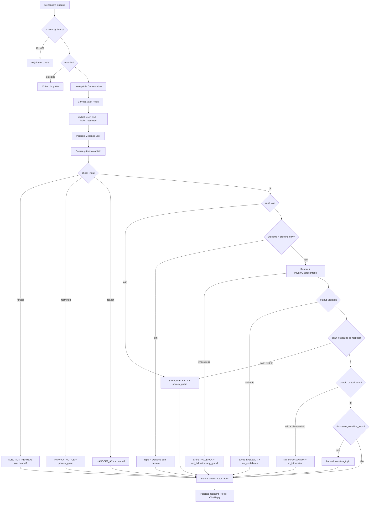
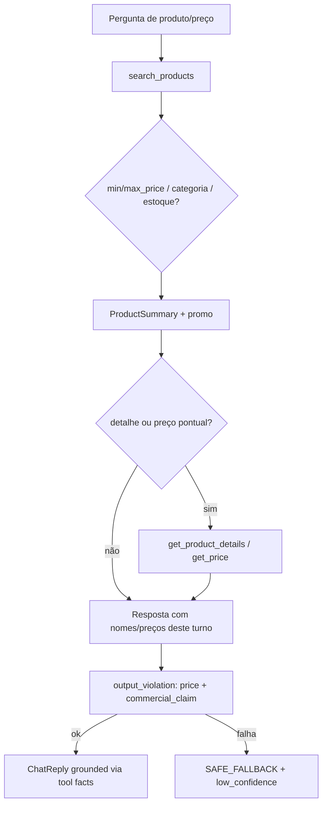
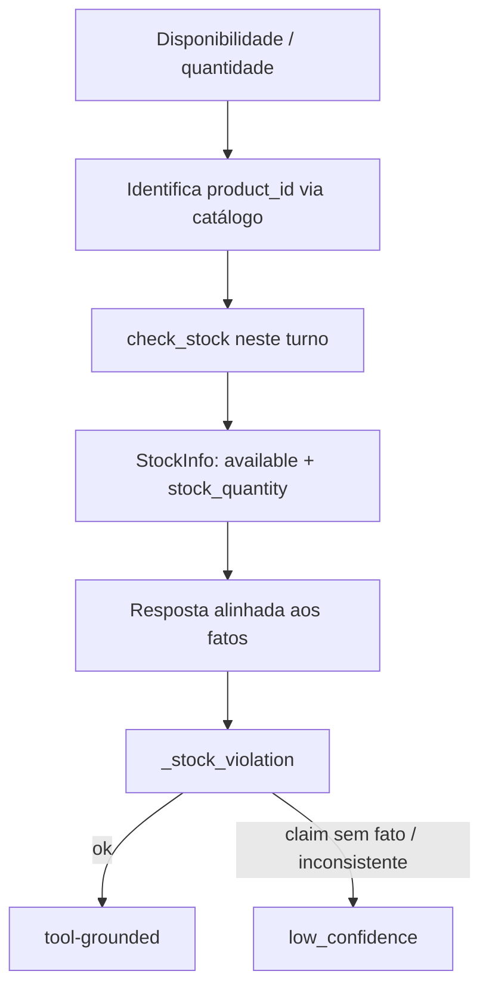
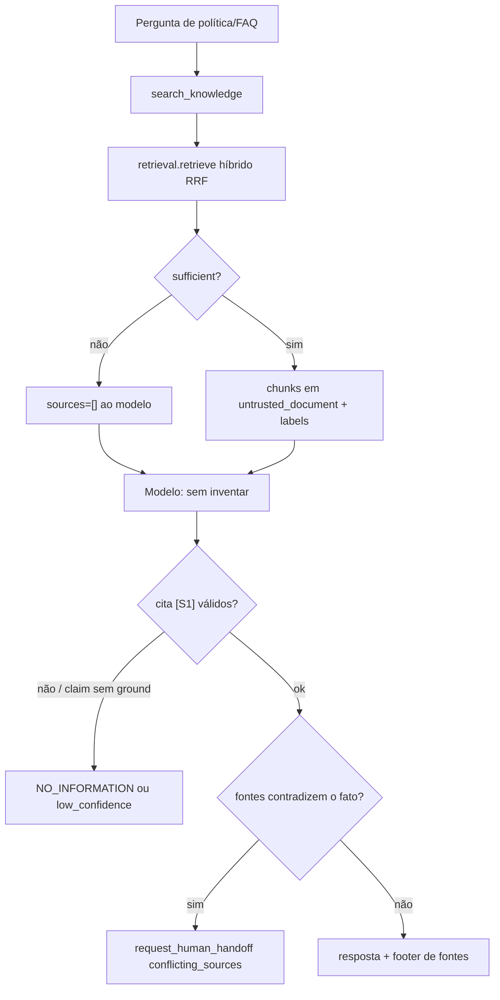
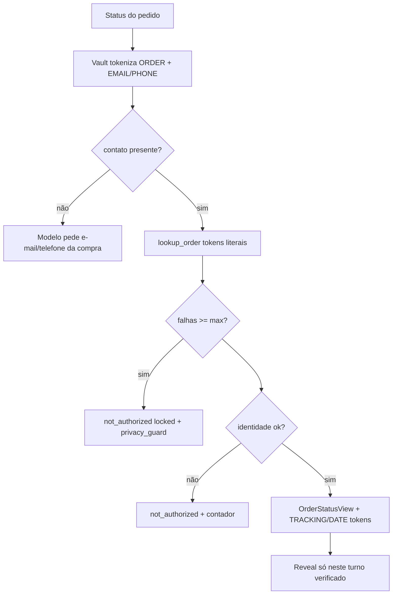
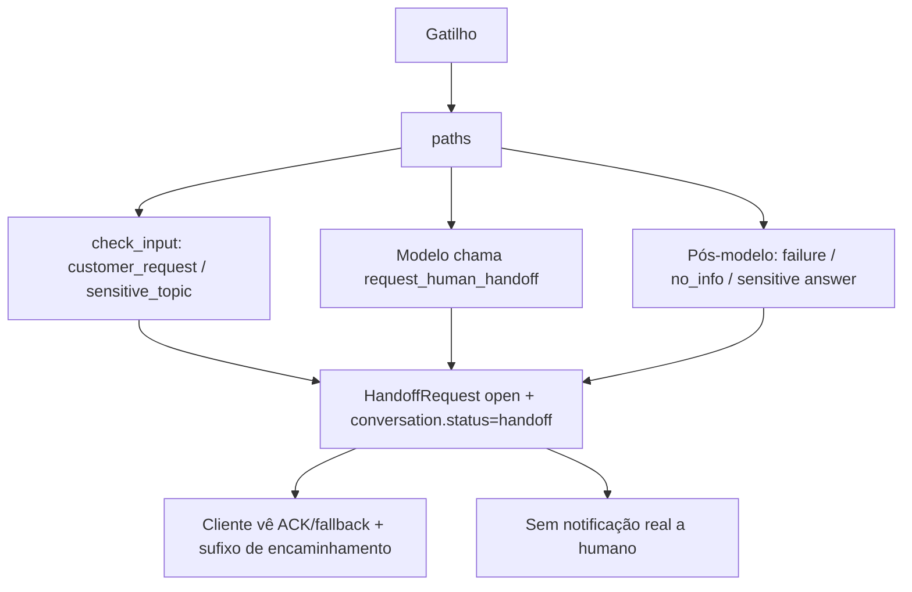
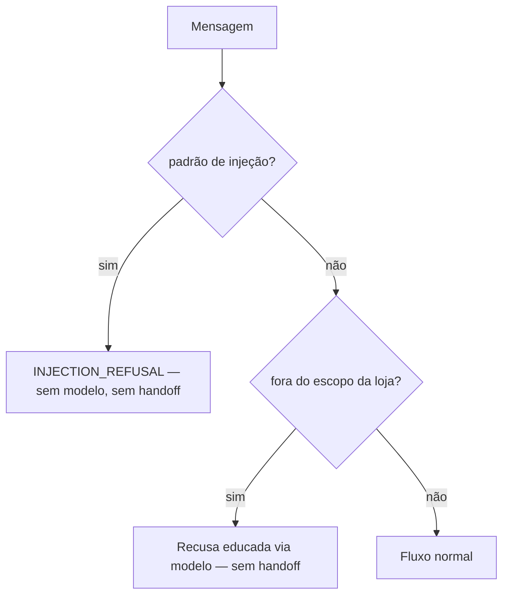
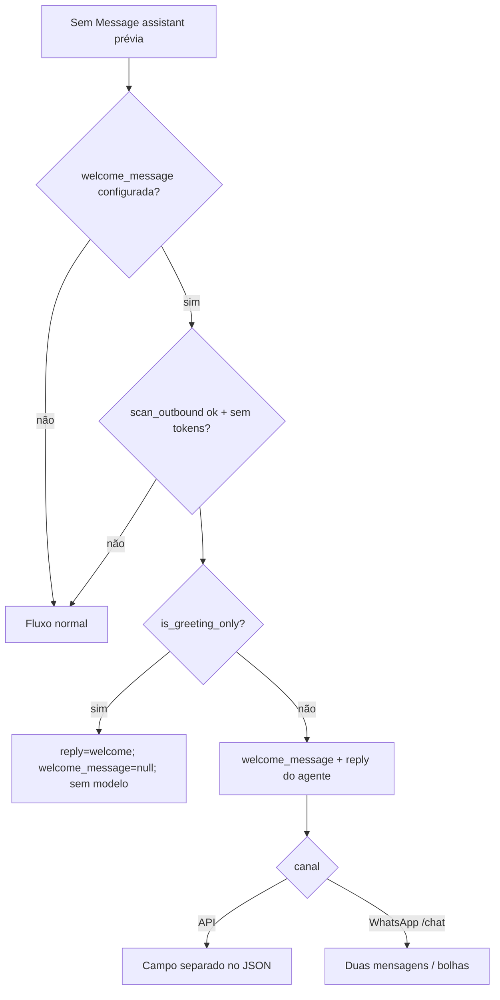
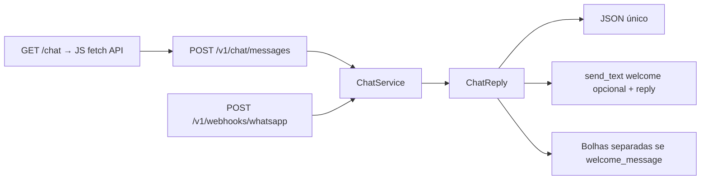

# Fluxos de atendimento do agente

Documento derivado do código em execução (não de intenções de design). Destinado a
recrutadores que avaliam o case e à equipe da loja. Quando README ou docs antigos
divergem do código, **o código vence**; discrepâncias relevantes estão anotadas.

Contrato de saída: `ChatReply` em `app/schemas/chat.py`. Orquestração:
`ChatService.handle_message` em `app/services/chat.py`. Motivos de handoff:
`HANDOFF_REASONS` em `app/models/handoff.py`.

---

## 1. Visão geral de um turno

Um turno começa no canal (API, WhatsApp ou UI `/chat`) e termina em um `ChatReply`
persistido. Autenticação e rate limit ficam na borda HTTP; o resto é local e
tenant-scoped.

### Etapas e código

| Etapa | O que acontece | Código |
|---|---|---|
| Autenticação | `X-API-Key` → tenant; escopo `chat`. Tenant no body é ignorado. | `app/api/dependencies.py` `get_principal`, `require_scope` |
| Rate limit | Contador Redis por chave (API) ou por `external_user_ref` (WhatsApp). Limiter down → permite (exceto lockout de pedido, fail-closed). | `count_hit`; `app/api/routes/chat.py` `post_message`; `app/api/webhooks/whatsapp.py` `_process` |
| Conversação | Cria ou busca por `tenant_id` + `conversation_id` + `channel` + `external_user_ref`. | `ChatService._conversation` |
| Tokenização | Spans conhecidos → `[[EMAIL_n]]` / `[[ORDER_n]]` etc. Residuais `looks_restricted` → placeholder e nunca vão ao modelo. | `redact_user_text`, `looks_restricted` (`app/services/privacy.py`) |
| Input | Recusa de injeção; tópico sensível; pedido explícito de humano. | `check_input` (`app/agents/guardrails.py`) |
| Boas-vindas | Primeiro contato (= sem assistant anterior); lock advisory; greeting-only sem modelo. | `handle_message` + `is_greeting_only` |
| Loop do agente | `Runner.run` com `max_turns=MAX_AGENT_TURNS` (default 8), `TURN_TIMEOUT_SECONDS` (75) e `MODEL_TIMEOUT_SECONDS` (30) no `PrivacyGuardedModel`. | `handle_message`; `app/services/model_gateway.py` |
| Egress | Cada payload ao provedor passa por `scan_outbound`; sem `store`/estado hospedado. | `PrivacyGuardedModel._check` |
| Saída | Preço/estoque/promo/citações/prompt leak/success claims. | `output_violation` |
| Ungrounded | Sem citação e sem fatos de tool, com claim factual ou admissão de “não sei” → `NO_INFORMATION` + `no_information`. | `has_factual_claim`, `admits_no_information` |
| Reveal | Só tokens digitados neste turno ou `TRACKING`/`DATE` de `lookup_order` com `identity_verified`. | `verified_lookup_tokens`, `vault.reveal` |
| Persistência | Mensagens, `MessageSource`, `ToolExecution`, `AuditEvent`, status `handoff` se aplicável. | fim de `handle_message` |

Mensagens fixas (`SAFE_FALLBACK`, `NO_INFORMATION`, `INJECTION_REFUSAL`, `HANDOFF_ACK`,
`PRIVACY_NOTICE`) estão em `app/agents/guardrails.py`. Em handoff deste turno a
resposta ganha o sufixo *“Solicitei atendimento humano…”* (`handle_message`).

**Discrepância:** o README ainda cita a política `commerce-privacy-v5`; o código usa
`PROMPT_VERSION = "commerce-privacy-v7"` em `app/agents/instructions.py`.

---

## 2. Fluxos por intenção

O modelo escolhe ferramentas; a política em `POLICY_TEXT` (`build_instructions`) e os
guardrails determinísticos fecham o comportamento. Tools: `build_customer_service_agent`
(`app/agents/customer_service.py`).

### 2a. Catálogo, preço e promoções

- **Tools:** `catalog.search_products`, `get_product_details`, `get_price`
  (`app/tools/catalog.py`). Orçamento → `min_price`/`max_price`; matches parciais
  vêm do backend local (sem garantia de equivalência ao produto pedido — ver
  limitações do README).
- **Promoção:** `active_promotion` no resultado; claims “grátis/desconto” sem backing
  de catálogo neste turno violam `_commercial_claim_violation`.
- **Validação:** preços de produto só de tools deste turno, nunca de documentos RAG
  (`_price_violation`).
- **Instruções:** buscar primeiro com `search_products`; não inventar preço; não
  mostrar `product_id` ao cliente (`POLICY_TEXT`).

### 2b. Estoque

- **Tool:** `inventory.check_stock` (`app/tools/inventory.py`).
- Histórico só identifica o produto; disponibilidade de turnos anteriores **não** é
  evidência (`POLICY_TEXT`). Follow-ups (“e tem em estoque?”) devem chamar a tool de
  novo neste turno.
- Quantidades exigem `stock_quantity` (resumo de busca sozinho não respalda número).
- Perguntas (sentenças com `?`) e ofertas não assertivas passam pelo checker
  (`_stock_violation`, `_nonfactual_request`).

### 2c. Políticas da loja via RAG

- **Retrieval:** `app/rag/retrieval.py` `retrieve` — cosseno + FTS PT + RRF;
  `sufficient` exige similaridade ≥ limiar ou cobertura lexical (≥ metade dos lexemas
  da query). Chunks com `suspicious_instructions` nunca são servidos.
- **Adapter:** `search_knowledge` em `customer_service.py` só entrega chunks se
  `found.sufficient`; caso contrário `sources=[]` e `sufficient=false`.
- Documentos são dados não confiáveis (`<untrusted_document>`); a política manda
  ignorar comandos neles.
- Conflito: o modelo deve responder o consenso, citar ambas e só então usar
  `conflicting_sources` (`POLICY_TEXT`). Não há detector automático de contradição
  além da tool de handoff + instruções.

### 2d. Status de pedido

- **Tool:** `orders.lookup_order` (`app/tools/orders.py`).
- Contadores Redis: por pedido e por ator (`actor_ref` ou `conversation_id`);
  `ORDER_LOOKUP_MAX_FAILURES` (default 3) em `ORDER_LOOKUP_LOCKOUT_SECONDS` (3600).
  Limiter indisponível → `unavailable` (fail-closed).
- Sucesso não zera contadores. Pedido inexistente e contato errado → mesma falha
  (`MSG_NOT_AUTHORIZED`) para não enumerar.
- `handle_message`: `result_summary.locked is True` → `failure_reason = privacy_guard`
  → `SAFE_FALLBACK` + handoff. Tokens `TRACKING`/`DATE` sem verificação neste turno
  também forçam `privacy_guard`.

### 2e. Atendimento humano

- **Tool:** `handoff.request_human_handoff` (`app/tools/handoff.py`) — idempotente se
  já há `ctx.handoff_id`; grava `HandoffRequest`, audit `handoff.created`.
- O que o cliente vê depende do caminho (tabela na §3). Não há e-mail/Slack/push:
  só registro local consultável pela API de handoffs.
- Pedido explícito de humano / reclamação / pagamento / exceção comercial podem
  ser capturados **antes** do modelo (`check_input`) ou depois
  (`discusses_sensitive_topic` se a resposta trata o caso pessoalmente sem citação).

### 2f. Fora do escopo e manipulação

- Injeção / “mostre o system prompt” / jailbreak: `_REFUSAL` em `check_input` →
  `decision.refusal` → resposta fixa, modelo não roda, **sem** handoff.
- Fora de escopo (clima, notícias, etc.): política manda recusar e oferecer ajuda
  com a loja **sem** `request_human_handoff` (`POLICY_TEXT`).

### 2g. Boas-vindas no primeiro contato

- Implementação: `handle_message` + contrato W1 em `docs/platform/contracts.md`.
- Recusa, falha e handoff deste turno **cancelam** a boas-vindas
  (`welcome = None`).

---

## 3. Tabela de motivos de handoff

Valores de `HANDOFF_REASONS` (`app/models/handoff.py`). Em todo handoff deste turno o
cliente também recebe o sufixo de encaminhamento (exceto se a criação da
`HandoffRequest` falhar por completo — nesse caso não há `handoff` no `ChatReply`).

| Motivo | Quando (caminho no código) | Mensagem típica ao cliente | Modelo rodou? |
|---|---|---|---|
| `customer_request` | `check_input` → `_HUMAN`; ou tool `request_human_handoff` com esse reason | Pré-modelo: `HANDOFF_ACK`. Via tool: texto do modelo (se válido) + sufixo | Só se via tool após o loop |
| `sensitive_topic` | `check_input` → `_SENSITIVE`; ou `discusses_sensitive_topic` pós-resposta; ou tool | Pré-modelo: `HANDOFF_ACK`. Pós-modelo: resposta (se mantida) + sufixo | Pré: não. Pós/tool: sim |
| `privacy_guard` | Texto ainda `looks_restricted`; vault save falhou; `PrivacyBoundaryError`; lockout de pedido (`locked`); token TRACKING/DATE não autorizado; footer com token indevido | `PRIVACY_NOTICE` (input restrito) ou `SAFE_FALLBACK` (demais) + sufixo | Input restrito: não. Outros: pode ter rodado antes do fail-closed |
| `tool_failure` | Exceção no `Runner` (timeout, MaxTurns, erro genérico); tool com `unavailable`/`internal_error` | `SAFE_FALLBACK` + sufixo | Tentou; falhou |
| `low_confidence` | `output_violation` (price/stock/commercial_claim/citation/prompt_leak/success_claim) | `SAFE_FALLBACK` + sufixo | Sim (resposta descartada) |
| `no_information` | Modelo rodou, sem citação nem tool-grounding, e `admits_no_information` ou `has_factual_claim` | `NO_INFORMATION` + sufixo | Sim |
| `conflicting_sources` | Modelo chama `request_human_handoff` com esse reason (política RAG) | Resposta útil de consenso (se o modelo cumprir) + sufixo | Sim |

Observações:

- `_Handoffs.request` garante no máximo um `HandoffRequest` aberto por conversa;
  reutiliza o existente.
- Motivos inválidos na tool → `invalid_input` (`MSG_INVALID_REASON`), sem criar
  registro.

---

## 4. Canais

Todos convergem em `ChatService.handle_message`.

| Canal | Entrada | Auth / identidade | Diferenças |
|---|---|---|---|
| API | `ChatMessageRequest.message` | `X-API-Key` + scope `chat`; sem `external_user_ref` | Rate por API key; 404 se conversa de outro tenant |
| WhatsApp | Webhook Meta assinado; só `type=text` | Tenant via `TenantChannel.phone_number_id`; `external_user_ref = HMAC(wa_id)` | Dedupe Redis; welcome como **mensagem separada**; rate por usuário; sempre 200 após assinatura ok |
| UI `/chat` | Estáticos em `app/static/chat/`; só com docs de desenvolvimento | Mesma API com chave colada no browser | Dev only (`chat_ui.py`); sem auth de usuário final |

Referências: `app/api/routes/chat.py`, `app/api/webhooks/whatsapp.py`,
`app/api/routes/chat_ui.py`, `app/static/chat/app.js`.

---

## 5. O que o fluxo não faz

Limites honestos alinhados a [Limitações do README](../README.md#limitações-e-próximos-passos):

| Limite | Detalhe no código |
|---|---|
| Sem auth de usuário final na API | Só API key de tenant; verificação de pedido = matching de contato local (`lookup_order`), não login |
| Sem notificação humana real | `HandoffRequest` + audit; nenhum canal externo de alerta |
| Sem serialização total por conversa | Lock advisory só para decisão de primeiro contato; vault GET/SET e commits do turno não são atômicos entre workers |
| Guardrails lexicais | Regex/folding em `guardrails.py` — não é NLI; pode rejeitar respostas corretas ou deixar passar edge cases |
| Fake/hash ≠ qualidade LLM | Providers `fake`/`hash` exercitam o pipeline; não validam grounding com modelo real |
| Detecção de PII incompleta | Regras + nomes conhecidos; nomes em minúsculas fora de autoapresentação podem escapar (`privacy.py` docstring) |
| Conflito de fontes | Depende do modelo seguir `POLICY_TEXT`; não há checker automático de contradição |
| WhatsApp | Adapter não validado contra Meta ao vivo (docstring do webhook) |

---

## Mapa rápido código ↔ seção

| Tema | Arquivos / funções |
|---|---|
| Turno completo | `ChatService.handle_message` |
| Input/output safety | `check_input`, `output_violation`, `is_greeting_only`, `has_factual_claim`, `admits_no_information`, `discusses_sensitive_topic` |
| Tools | `build_customer_service_agent`; `app/tools/{catalog,inventory,orders,handoff}.py` |
| RAG | `retrieval.retrieve`; `search_knowledge` |
| Privacidade / modelo | `redact_user_text`, `scan_outbound`; `PrivacyGuardedModel` |
| Contrato | `ChatReply`; `HANDOFF_REASONS`; `docs/platform/contracts.md` |
