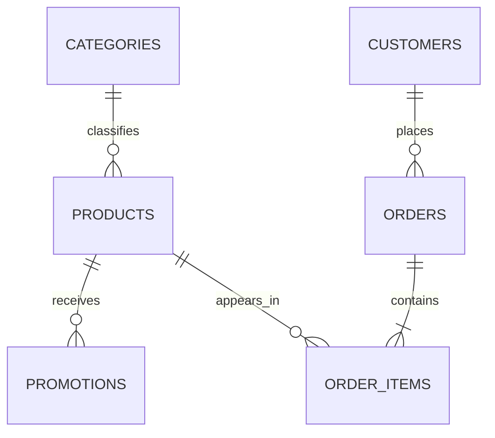

# Emporio da Musica Agent Data Contracts

## Purpose

This document defines the supplied data sources, relational rules, normalization,
validation, privacy classification and derived values. These contracts prevent silent data
repair and ensure models receive only bounded, verified facts.

## Source inventory

| Source | Rows | Primary key | Privacy class | Purpose |
|---|---:|---|---|---|
| `categories.csv` | 9 | `category_id` | Public | Product classification |
| `products.csv` | 65 | `product_id` | Public | Catalog, stock, prices and specifications |
| `promotions.csv` | 25 | `promotion_id` | Public | Product discounts and active state |
| `customers.csv` | 50 | `customer_id` | Restricted | Local identity verification |
| `orders.csv` | 20 | `order_id` | Restricted | Local order status and delivery data |
| `order_items.csv` | 22 | Composite logical key | Restricted when linked to an order | Order-product relationship |
| Policy manual | 8 PDF pages | Curated `section_id` | Public/internal policy | Customer-service rules |

Counts are a 2026-10-31 snapshot and are validated at ingestion rather than hard-coded as
permanent limits.

## Relational model



All supplied foreign keys currently resolve and all declared entity identifiers are
unique. Ingestion must fail on duplicate primary keys or orphan references.

## Category contract

| Field | Internal type | Required | Rule |
|---|---|---:|---|
| `category_id` | positive integer | Yes | Unique |
| `name` | non-empty string | Yes | Trim surrounding whitespace |
| `description` | non-empty string | Yes | Data, never instructions |

Categories 6-8 currently have no products. An empty category is valid and must not be
reported as an ingestion error.

## Product contract

| Field | Internal type | Required | Rule |
|---|---|---:|---|
| `product_id` | positive integer | Yes | Unique |
| `price_brl` | decimal with two display places | Yes | Greater than or equal to zero; never use binary float for final money |
| `name` | non-empty string | Yes | Preserve display form; create separate normalized search value |
| `category_id` | positive integer | Yes | Must reference a category |
| `description` | non-empty string | Yes | Untrusted catalog data |
| `stock_quantity` | non-negative integer | Yes | Zero means unavailable |
| `status` | enum | Yes | `active`, `discontinued`, `coming_soon` |
| `specs` | JSON object | Yes | Parse from CSV string; reject invalid JSON |
| `created_at` | date | Yes | ISO date |

Availability is true only when `status == active` and `stock_quantity > 0`. A model may not
infer availability from stock or status alone.

Current status distribution: 62 active, 2 discontinued and 1 coming soon.

## Promotion contract

| Field | Internal type | Required | Rule |
|---|---|---:|---|
| `promotion_id` | positive integer | Yes | Unique |
| `product_id` | positive integer | Yes | Must reference a product |
| `discount_percent` | decimal | Yes | Between 0 and 100 exclusive |
| `description` | non-empty string | Yes | Display label, not authorization |
| `is_active` | boolean | Yes | Normalize only `0` and `1` |

Only `is_active == 1` is eligible. Four of the supplied promotions are active: IDs 12, 14,
19 and 24.

Promotional price uses decimal arithmetic:

```text
promotional_price = money_round(price_brl * (1 - discount_percent / 100))
```

The 5% PIX discount does not apply to a promotional price. Code chooses the applicable
rule; the model only explains the result.

## Customer contract

| Field | Internal type | Required | Rule |
|---|---|---:|---|
| `customer_id` | positive integer | Yes | Unique; never sent externally |
| `name` | restricted string | Yes | Used locally; passed to egress guard as known restricted value |
| `phone` | normalized restricted phone | Yes | Preserve display copy separately; compare normalized digits |
| `email` | normalized restricted email | Yes | Case-insensitive comparison |
| `city` | restricted string | Yes | Never required for identity verification in the MVP |

Repositories expose verification operations, not unrestricted customer records. No tool
returns a stored phone or email to a model.

## Order contract

| Field | Internal type | Required | Rule |
|---|---|---:|---|
| `order_id` | positive integer | Yes | Unique and restricted |
| `customer_id` | positive integer | Yes | Must reference a customer |
| `order_date` | date | Yes | ISO date |
| `status` | enum | Yes | `delivered`, `shipped`, `confirmed`, `pending`, `cancelled` |
| `total_brl` | decimal money | Yes | Greater than or equal to zero |
| `payment_method` | controlled string | Yes | Validate against observed/approved methods |
| `tracking_code` | optional restricted string | No | Present only when assigned; validate configured format |
| `estimated_delivery` | optional date | No | May be absent for non-shipped states |
| `notes` | optional restricted string | No | Untrusted free text; never sent externally raw |

The supplied file has 12 empty tracking codes, 12 empty estimated-delivery values and 16
empty notes. These are valid nulls. Empty strings normalize to `None`.

Current status distribution: 7 delivered, 1 shipped, 4 confirmed, 4 pending and 4
cancelled.

## Order item contract

| Field | Internal type | Required | Rule |
|---|---|---:|---|
| `order_id` | positive integer | Yes | Must reference an order |
| `quantity` | positive integer | Yes | Greater than zero |
| `product_id` | positive integer | Yes | Must reference a product |

The tuple `(order_id, product_id)` is the logical uniqueness key unless future data permits
multiple lines for the same product. Order items inherit restricted classification when
joined to an order or customer.

## Policy knowledge contract

The curated policy artifact uses this structure:

```text
PolicySection
  section_id: stable dotted identifier
  intent: controlled enum
  title: string
  canonical_text_pt_br: string
  keywords: list[string]
  manual_version: string
  source_page: positive integer
  effective_date: optional date
```

Required initial identifiers include `hours`, `payment`, `returns.online`,
`returns.defect`, `returns.preference`, `shipping.metro`, `shipping.other`, `promotions`,
`service`, `warranty` and `privacy`.

The curated representation is reviewed against the source PDF and versioned. It may
summarize layout but must preserve conditions, exceptions, periods and amounts.

## Normalization rules

- Unicode normalize searchable text and compare case-insensitively while preserving the
  original display value.
- Parse currency through `Decimal`, quantized for BRL display.
- Parse ISO dates as date objects; add timezone only to event timestamps.
- Normalize phones to country/area/local digits for comparison and mask them in displays.
- Normalize emails with trimmed whitespace and case-insensitive comparison.
- Convert CSV `0`/`1` booleans explicitly; reject other values.
- Convert empty optional fields to `None`.
- Validate `specs` as a JSON object, not an arbitrary JSON scalar.

## Source precedence

1. Current validated operational repository for product, stock, promotion and order facts.
2. Versioned policy knowledge for service rules.
3. System behavior and security policy.
4. Conversation state.
5. User claims.

A lower source never overwrites a higher source. User-provided prices, discounts and order
states are treated as claims that require verification.

## Ingestion behavior

Startup validation reports all row errors together when safe, then fails before serving
requests. It must not silently drop, coerce or repair a row beyond the documented
normalization rules.

Validation covers:

- file presence, encoding, headers and unexpected columns;
- primary-key uniqueness and foreign-key integrity;
- enum, numeric, date, boolean and JSON parsing;
- non-negative money and stock;
- optional-field handling;
- privacy classification attached to repository outputs.

## Data lifecycle

- Original CSV/PDF fixtures are read-only.
- Derived SQLite and policy-index artifacts are reproducible and disposable.
- Customer/order data remains local and is excluded from external prompts, logs and eval
  exports.
- Session authorization mappings expire with the session.
- Production retention and deletion schedules must be defined before real data is used.

## Contract tests

`tests/test_source_data_contract.py` currently verifies critical fixture facts, expected
promotion state, unavailable-product fixtures, order/customer relationships and PIX
arithmetic. Phase 1 expands this into row-level schema, relationship and normalization
tests for every source.

