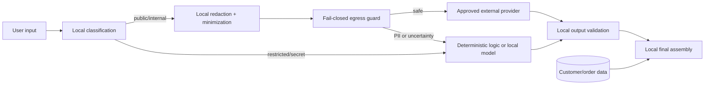

# Privacy and data protection architecture

## Non-negotiable rule

Raw personal data does not cross an external model-provider boundary. No-training terms,
paid plans, encryption and zero-data-retention controls are valuable defense in depth, but
they do not authorize sending customer data.

## What remains local

- Customer names, phones, emails and addresses.
- Customer and order identifiers.
- Order items, tracking codes and delivery details linked to a person.
- Identity-verification inputs and authorization tokens.
- Raw conversation history, complaints and free text containing PII.
- The mapping between short-lived pseudonyms and real records.

Identity verification and authorization always run in deterministic local code. The final
answer may include an authorized tracking code, but trusted application code inserts it
after any language-model generation.

## What an external model may receive

- Public product and policy information.
- A minimized non-identifying request.
- Abstract state such as `identity_verified=true`, `order_status=shipped` and
  `has_tracking=true`.
- No joinable identifier or raw history.

The outgoing object is classified again after serialization. The external call is blocked
if the guard finds restricted fields, phones, emails, order references, tracking codes,
postal codes, secrets or known customer values.

## Provider controls

Provider configuration is deny-by-default and cannot be overridden per request:

| Provider | Required normalized controls |
|---|---|
| OpenAI | `store=false`; no remote tools, file uploads, explicit customer-data cache or data contribution; approved ZDR when contractually required |
| Anthropic | ZDR-enabled/eligible workspace when required; no hosted tools, files, explicit customer-data cache or contribution |
| Google | `store=false`, API logging off, contribution off, grounding off, no files or explicit customer-data cache; use an enterprise path when guaranteed ZDR is required |

Official provider documentation changes over time and must be rechecked before production:

- OpenAI data controls: <https://developers.openai.com/api/docs/guides/your-data>
- Claude API retention: <https://platform.claude.com/docs/en/manage-claude/api-and-data-retention>
- Gemini zero retention: <https://ai.google.dev/gemini-api/docs/zdr>
- Gemini API logging: <https://ai.google.dev/gemini-api/docs/logs-policy>

## Logging and retention

- Operational logs contain route/classification decisions, not prompts or responses.
- Sensitive structured fields and detected PII are replaced with category placeholders.
- Security findings record only the finding kind and structural path, never the value.
- Raw session history has a bounded local TTL.
- Eval and human-review exports use synthetic or irreversibly anonymized data.
- Retention schedules, access control and deletion procedures must be set before production.

## LGPD alignment

The design applies purpose limitation, necessity/minimization, security, prevention,
transparency and accountability. It is an engineering control set, not a substitute for a
legal basis assessment, data-processing agreements, a privacy notice, data-subject request
procedures or a formal impact assessment.

Government summary of LGPD principles:
<https://www.gov.br/mdr/pt-br/acesso-a-informacao/perguntas-frequentes/perguntas-e-respostas-frequentes-sobre-lgpd/quais-principios-devem-nortear-o>

## Executable controls

`src/emporio_agent/privacy.py` provides:

- classification-based external processing denial;
- recursive payload scanning without logging detected values;
- log redaction;
- known-customer-value detection supplied by the trusted local repository;
- non-overridable normalized provider privacy defaults.

The current regex/rule guard is one layer. Before production, add data-loss-prevention
monitoring, structured schemas at every tool boundary, encrypted local storage, key
rotation, access review, incident response and tests using a broader multilingual PII set.
