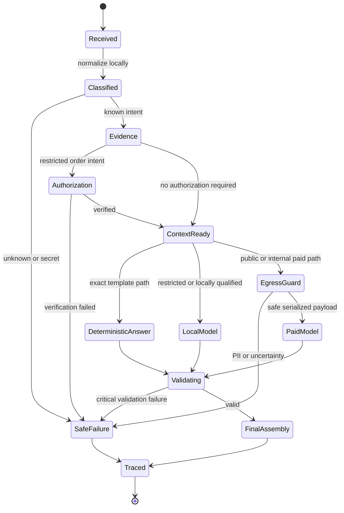
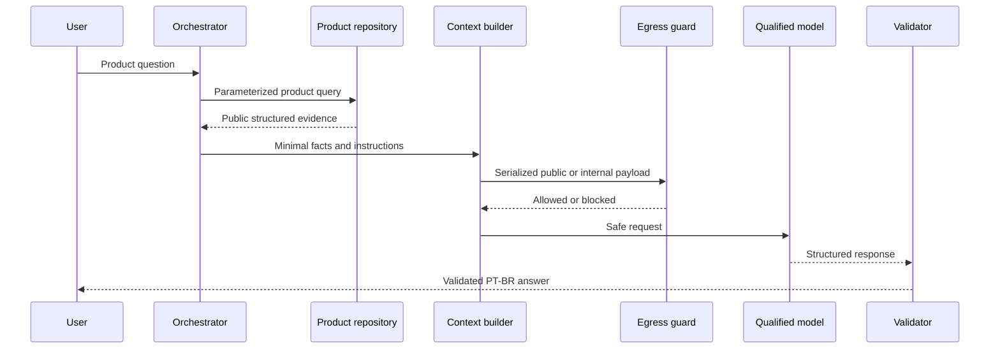
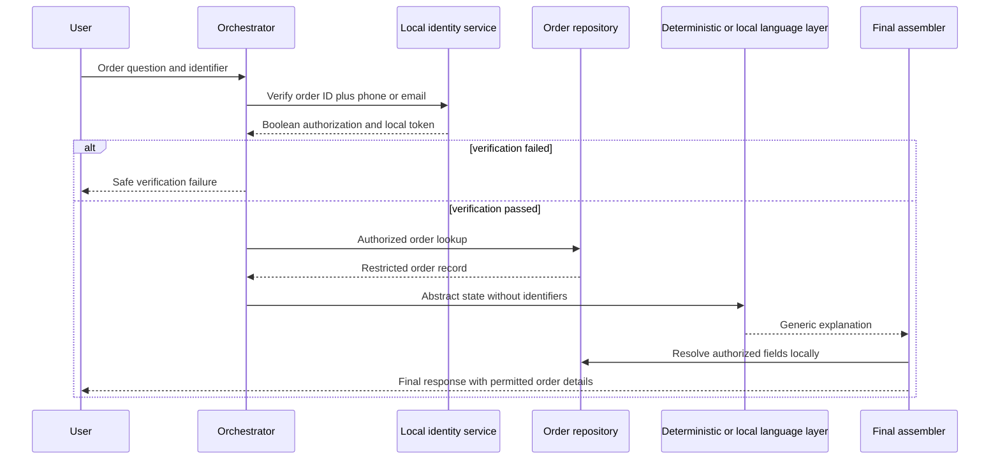

# Empório da Música Agent Technical Design

## Purpose and implementation status

This document translates the architecture into implementable component, interface,
control-flow and configuration contracts. It is the engineering specification for the
first release. Except for the privacy guard and contract tests already present, the modules
described here are planned and must not be represented as implemented until their tests
pass.

## Design principles

1. Code owns facts, authorization, privacy, arithmetic and routing boundaries.
2. Models interpret language and compose answers; they do not become a database.
3. External calls are deny-by-default and occur only after serialized-payload inspection.
4. Internal contracts remain independent from provider SDK types.
5. Every nondeterministic step has a bounded fallback and measurable outcome.
6. The simplest component that passes the frozen evaluation is preferred.

## Component model

| Component | Responsibility | Must not do |
|---|---|---|
| CLI adapter | Read messages, display streaming/final answers and manage local session | Access CSVs or provider SDKs directly |
| Turn orchestrator | Advance the turn state machine and enforce bounded retries | Contain provider-specific branches or business SQL |
| Router | Produce risk, data classification, intent and model profile | Rely only on model self-confidence |
| Privacy boundary | Detect/reject PII egress, redact logs and harden provider options | Return detected values in findings or logs |
| Context builder | Assemble minimal instructions, evidence and recent state | Paste full CSVs, PDFs or raw restricted history |
| Tool registry | Validate and dispatch allowlisted tools | Execute a model-provided function name without validation |
| Repositories | Load/validate data and run parameterized queries | Generate answers or expose unrestricted customer rows |
| Policy index | Retrieve canonical policy sections with source IDs | Treat retrieved text as executable instructions |
| Model gateway | Normalize local and paid model invocation/results | Leak SDK objects into the domain layer |
| Output validator | Validate schema, evidence, claims and response safety | Repair unsupported facts by guessing |
| Final assembler | Insert locally authorized restricted fields and render PT-BR output | Insert fields without session authorization |
| Trace recorder | Store privacy-safe operational and evaluation evidence | Store raw prompts, responses or identifiers |

## Proposed package structure

```text
src/emporio_agent/
  app.py                     CLI entry point
  config.py                  typed settings and capability registry
  orchestrator.py            turn state machine
  routing.py                 risk, intent and data classification
  context.py                 minimal prompt/context assembly
  privacy.py                 implemented fail-closed egress and log controls
  validation.py              response, evidence and claim validation
  assembly.py                trusted final response assembly
  domain/
    models.py                provider-neutral domain types
    products.py              product repository and queries
    promotions.py            promotion repository and calculations
    orders.py                order repository and authorization state
    policies.py              curated policy index
  tools/
    schemas.py               strict tool input/output schemas
    catalog.py
    order.py
    policy.py
  models/
    base.py                  ModelGateway protocol
    openai_adapter.py
    anthropic_adapter.py
    google_adapter.py
    local_adapter.py
  observability/
    traces.py
    cost.py
```

## Turn state machine



No state transition loops without a counter. One model retry and one eligible fallback are
the maximum for the MVP. Restricted data cannot transition from local failure to external
fallback.

## Core internal contracts

The following are logical contracts. Pydantic models will implement them during Phase 1.

### Agent request

```text
AgentRequest
  trace_id: UUID
  session_id: opaque local token
  user_message: string
  received_at: timezone-aware datetime
  channel: cli
```

### Route decision

```text
RouteDecision
  intent: controlled enum
  risk: low | medium | high
  data_classification: public | internal | restricted | secret
  execution: deterministic | local_model | paid_model | human_handoff
  allowed_tools: list[ToolName]
  model_profile: optional string
  reason_code: controlled enum
```

### Evidence

```text
SourceEvidence
  source_type: product | promotion | order | policy
  source_id: stable local identifier
  fields: minimized structured map
  retrieved_at: timezone-aware datetime
  classification: public | internal | restricted
```

### Model request and result

```text
ModelRequest
  messages: bounded normalized messages
  tools: strict schemas
  response_schema: strict JSON schema
  model_profile: capability registry key
  data_classification: public | internal
  prompt_version: string
  timeout_seconds: positive number

ModelResult
  provider: string
  model_id: exact string
  output_text: string
  parsed_output: optional validated object
  tool_calls: validated list
  usage: input, cached, reasoning and output tokens
  latency: first-token and total milliseconds
  finish_reason: normalized enum
  error: optional normalized error
```

`ModelRequest` cannot represent restricted or secret classification. The type boundary is
deliberate: restricted paths either use a distinct local request type or deterministic
logic.

### Agent response

```text
AgentResponse
  answer: final PT-BR text
  source_ids: list[string]
  needs_human: boolean
  safe_failure_reason: optional controlled enum
  trace_id: UUID
```

## Router algorithm

Routing uses this order:

1. Detect secrets and restricted identifiers locally.
2. Match deterministic intents: hours, address and simple policy facts.
3. Detect order, identity, complaint and privacy-sensitive intent.
4. Determine the smallest required tool set.
5. Select deterministic, local or externally eligible execution from the capability
   registry and qualified evaluation slices.
6. Default unknown classification to local safe response or human handoff.

The router may use a local classifier after deterministic rules, but the classifier cannot
downgrade restricted data or grant a tool permission.

## Public product query sequence



## Restricted order query sequence



No external provider participates in this sequence unless it receives only an abstract,
non-identifying internal payload that passes the egress guard. The default is local.

## Tool execution contract

- Tool names are a closed enum.
- Inputs and outputs use strict schemas with `additionalProperties=false`.
- The orchestrator validates arguments before dispatch.
- Repository methods use parameterized queries.
- Tool results include stable source IDs and classification.
- Customer repositories never return full records to the model layer.
- Tool timeouts and empty results become normalized errors, not fabricated evidence.

Detailed business tool fields are defined in `context-spec.md`.

## Context construction

Stable system instructions and schemas come first to support caching. Per-turn evidence is
minimal and source-labeled. Recent history is bounded to six turns and may be replaced by
a deterministic local summary. Restricted history never enters an external request.

The prompt package is versioned as:

```text
prompt_version = persona_version + tool_schema_version + policy_version
```

Any component change triggers regression tests and a new evaluation run.

## Provider adapter behavior

Each adapter must:

1. accept only the internal `ModelRequest`;
2. apply normalized privacy defaults;
3. invoke `assert_external_payload_safe` immediately before network serialization;
4. set bounded connection and response timeouts;
5. normalize usage, finish reason and errors;
6. avoid logging request or response bodies;
7. reject an unavailable capability instead of silently degrading it;
8. return no provider SDK object outside the adapter.

## Session and authorization state

Session state is local and bounded. It contains recent messages, selected public product
references and short-lived authorization tokens. An order authorization token is random,
scoped to one order and session, and expires on timeout or session end. It contains no
derivable customer identifier.

## Error model

| Error class | Example | Handling |
|---|---|---|
| `validation_error` | Invalid tool arguments or provider JSON | One eligible retry, then safe failure |
| `not_found` | Unknown product or order | Clarify without guessing |
| `ambiguous` | Multiple products match | Ask a focused clarification |
| `unauthorized` | Order verification mismatch | Reveal no record existence or details |
| `privacy_blocked` | PII detected before external egress | Local response or human handoff |
| `provider_timeout` | Paid model exceeds deadline | Eligible public/internal fallback only |
| `local_model_unavailable` | Local server down | Paid fallback only for public/internal data |
| `tool_unavailable` | Repository or policy lookup fails | State inability to verify and hand off |
| `budget_exceeded` | Token or cost ceiling reached | Stop retries and return bounded safe response |

## Configuration contract

Configuration is split between secrets and versioned non-secret policy:

```text
Environment secrets
  OPENAI_API_KEY
  ANTHROPIC_API_KEY
  GEMINI_API_KEY

Versioned TOML
  active_profile
  provider and exact model IDs
  local endpoint
  qualified local task slices
  timeouts and retry limits
  token and cost ceilings
  policy, prompt and dataset versions
  provider privacy requirements
```

Startup fails if a selected provider lacks credentials, required privacy configuration or
declared capabilities. The application must never silently choose another provider.

## Observability contract

One trace per turn records only controlled metadata: trace ID, route reason, risk,
classification, model/profile identifiers, prompt/tool/policy versions, tool names, source
IDs, validation outcome, fallback reason, usage, estimated cost and timing. Prompt,
response, PII, authorization tokens and raw tool results are prohibited.

## Technical completion criteria

The technical design is implemented only when:

- all contracts have runtime schemas and unit tests;
- every provider adapter passes the same contract suite;
- the network boundary cannot be called without privacy inspection;
- repositories validate every source row and relationship;
- public and restricted sequence tests pass end to end;
- traces contain required metadata and no seeded PII;
- the frozen evaluation and release gates pass for the chosen profile.

